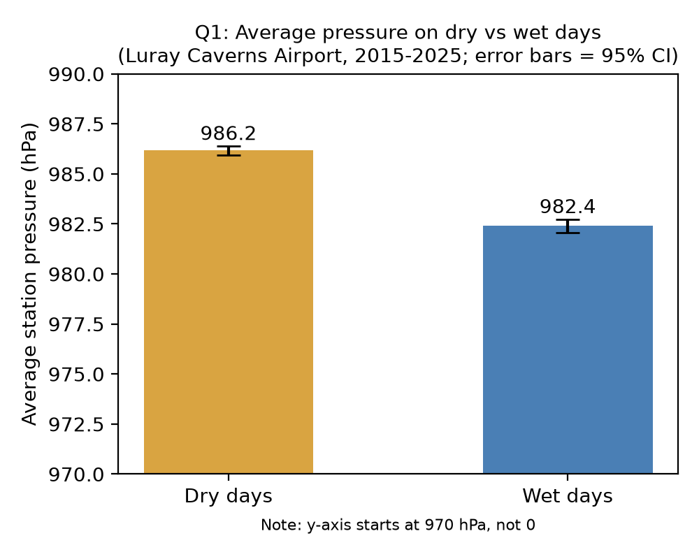
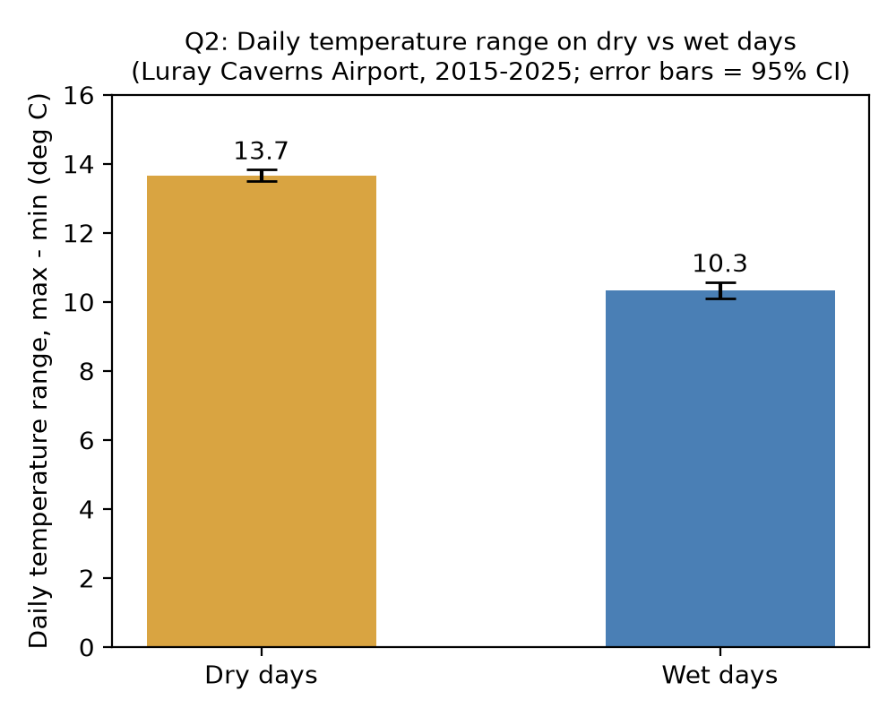
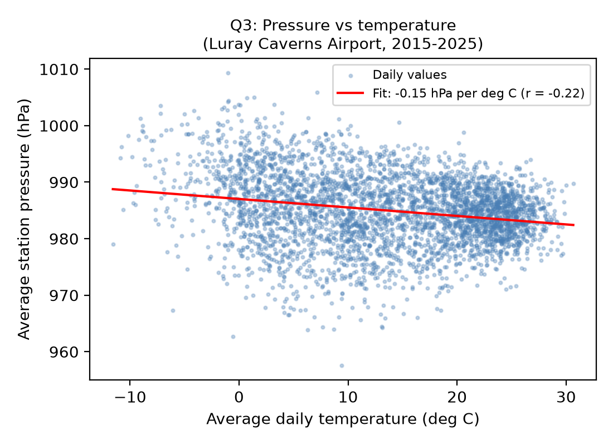

# What Does Airport Data Tell Us?

**Team Name:** Weatherboys

**Contributors:** Jego Osorio, Gavin White, Seth Leland

**Course:** ENGR 315 Computational Methods in Engineering

---

## Objective and Motivation

Weather affects flights, energy use and safety. We want to see how weather variables (pressure, temperature, rain) move together, and measure *how much* they differ or change, not just yes/no.

### Dataset

| | |
|---|---|
| **Name** | NOAA Local Climatological Data (LCD) |
| **What it is** | Hourly and daily readings from airport weather stations |
| **Download** | [data.gov listing](https://catalog.data.gov/dataset/u-s-local-climatological-data-lcd?from_hint=eyJxIjoibG9jYWwgY2xpbWF0b2xvZ2ljYWwifQ%3D%3D), [NOAA NCEI LCD v2](https://www.ncei.noaa.gov/access/search/datasets/local-climatological-data-v2/) |
| **How it was collected** | NOAA sensors and observers at airports, for aviation, forecasting and climate records |
| **Format / size** | Public CSV, one file per station per year, so easy to handle |
| **Useful columns** | `HourlyDryBulbTemperature`, `HourlyStationPressure`, `HourlyPrecipitation`, `DATE` |
| **Station used** | Luray Caverns Airport, VA (station ID USW00000416), 2015–2025, one CSV per year (about 15 MB each) |
| **Units in the files** | Temperature in °C, pressure in hPa, precipitation in mm |
| **Early look** | We first looked at a 3-month Asheville, NC sample (Jan–Mar 2017) to plan the questions, then switched to Luray for 11 years of data |

**Data quirks we found:** this station has only hourly rows (about 3 per hour); the `Daily...` columns are all empty, so we build daily values ourselves from the hourly readings. `HourlyPrecipitation` is blank when there was no precipitation. Station pressure is missing for some hours (about 36% of 2025 rows). Temperatures are whole °C.

### Questions We Are Asking

| # | Question | Expected form of the answer | Potential benefit |
|---|---|---|---|
| Q1 | Is air pressure lower on wet days than dry days? | Two average pressures (wet vs dry) and how big the gap is | Pressure could help signal incoming rain |
| Q2 | Is the daily temperature range (max − min) smaller on wet days? | Two average ranges (°C) and how big the gap is | Helps plan for energy use and comfort on rainy days |
| Q3 | How does air pressure change with temperature? | A fitted line and how strong the trend is | Shows whether temperature alone says anything about pressure |

**Other candidate questions we looked at (not selected):** Q4 winter vs summer high temperatures, Q5 size of the 24-hour temperature cycle by season, Q6 snow depth vs night-time low (not possible: snow depth is mostly blank).

**Why Q1–Q3:** we are interested in how wet and dry days compare, and in how pressure relates to temperature.

---

## Introduction / Context

- A **wet day** is a day where the station reported any precipitation (greater than 0 mm) in at least one hourly reading. All other days are dry.
- **Daily values** are made from the hourly rows: daily max and min temperature, average temperature, and average station pressure. Days with fewer than 18 readings are skipped.
- **Daily temperature range** = daily max temp − daily min temp.
- **Station pressure** is the pressure measured at the station's own elevation (Luray is at about 275 m elevation), so values are lower than sea-level pressure.

---

## Implementation Details

All three questions use daily values from the same cleaned table (one row per day), so the cleaning step is shared.

**Shared cleaning steps**
1. Load the 11 yearly CSVs with pandas (`scripts/daily_data.py`, used by all three question scripts).
2. Convert the hourly columns to numbers. Blank precipitation means none.
3. Group by day to get max/min/average temperature and average pressure. Skip days with fewer than 18 readings.
4. Make a `wet` column (any precipitation > 0 mm) and a `temp_range` column (max − min).

**Python packages:** `pandas`, `numpy`, `scipy` (t-test, linear fit), `matplotlib` (plots). Nothing else is needed.

### Q1: Pressure on wet vs dry days
- **Method:** two-sample (Welch) t-test.
- **Metrics:** average pressure (hPa) for wet days and dry days, difference of the averages, t-statistic, p-value.
- **Tools:** `pandas` (group by wet/dry), `scipy.stats.ttest_ind(..., equal_var=False)`.
- **Plot:** bar chart of the two averages (or a box plot), labeled in hPa.
- **Expected:** wet days have lower average pressure.
- **Result (Luray, 2015–2025, 3,835 days):** wet 982.4 vs dry 986.2 hPa (1,199 wet and 2,636 dry days).



### Q2: Temperature range on wet vs dry days
- **Method:** two-sample (Welch) t-test.
- **Metrics:** daily range (max − min, °C) for wet and dry days, difference of the averages, t-statistic, p-value.
- **Tools:** `pandas`, `scipy.stats.ttest_ind(..., equal_var=False)`.
- **Plot:** bar chart of the two averages (or a box plot), labeled in °C.
- **Expected:** wet days have a smaller range, because clouds block sunlight in the day and trap heat at night.
- **Result (3,998 days):** wet 10.3 vs dry 13.7 °C (1,236 wet and 2,762 dry days).



### Q3: Pressure vs temperature
- **Method:** linear fit (straight line) plus a correlation test.
- **Metrics:** slope (hPa per °C), intercept, correlation r, p-value.
- **Tools:** `scipy.stats.linregress` (or `numpy.polyfit`), `scipy.stats.pearsonr`.
- **Plot:** scatter plot of daily avg pressure (y) vs daily avg temperature (x) with the fitted line, axes labeled with units.
- **Expected:** little or no trend, so the line should be nearly flat.
- **Result (3,823 days):** slope about −0.15 hPa per °C, r = −0.22. The trend is real but weak (temperature explains about 5% of the pressure changes).



### Planned additions (later phases)
- Screenshots: block diagram of the workflow, key code snippets, top-level code.

---

## Results (Answers to the Questions)

Each question has its own Python script. All numbers and plots below come from running these scripts on the Luray Caverns Airport data (2015-2025).

| Question | Script | Command output | Plot |
|---|---|---|---|
| Q1 | `scripts/q1_pressure_wet_vs_dry.py` | `results/q1_output.txt` | `results/q1_plot.png` |
| Q2 | `scripts/q2_temp_range_wet_vs_dry.py` | `results/q2_output.txt` | `results/q2_plot.png` |
| Q3 | `scripts/q3_pressure_vs_temp.py` | `results/q3_output.txt` | `results/q3_plot.png` |

### Q1: Is pressure lower on wet days than dry days?
```
Q1: Average station pressure, wet days vs dry days (Luray Caverns Airport, 2015-2025)
----------------------------------------------------------------------
Days used:               3835  (wet = 1199, dry = 2636)
Wet days mean pressure:  982.40 hPa  (std dev 5.91)
Dry days mean pressure:  986.17 hPa  (std dev 6.00)
Difference (wet - dry):  -3.76 hPa
95% CI of difference:    [-4.17, -3.36] hPa
Welch t-statistic:       -18.19   (df = 2351)
p-value:                 2.83e-69
Effect size (Cohen's d): -0.63
Conclusion: wet days have significantly lower pressure (p < 0.05)
Saved results/q1_plot.png
```


### Q2: Is the daily temperature range smaller on wet days?
```
Q2: Daily temperature range (max - min), wet days vs dry days (Luray Caverns Airport, 2015-2025)
----------------------------------------------------------------------
Days used:               3998  (wet = 1236, dry = 2762)
Wet days mean range:     10.33 deg C  (std dev 4.26)
Dry days mean range:     13.66 deg C  (std dev 4.57)
Difference (wet - dry):  -3.33 deg C
95% CI of difference:    [-3.62, -3.04] deg C
Welch t-statistic:       -22.30   (df = 2532)
p-value:                 9.82e-101
Effect size (Cohen's d): -0.75
Conclusion: wet days have a significantly smaller range (p < 0.05)
Saved results/q2_plot.png
```


### Q3: How does pressure change with temperature?
```
Q3: Average station pressure vs average temperature (Luray Caverns Airport, 2015-2025)
----------------------------------------------------------------------
Days used:                 3823
Fitted line:               pressure = -0.150 * temp + 987.0   (hPa, temp in deg C)
Slope:                     -0.150 hPa per deg C   (95% CI [-0.171, -0.129])
Correlation r:             -0.218
R-squared:                 0.048  (temperature explains 4.8% of the pressure changes)
p-value (slope = 0):       2.17e-42
Spearman rank corr.:       -0.211  (p = 6.73e-40)
Conclusion: weak but statistically significant negative trend
Saved results/q3_plot.png
```


## Conclusions

- **Q1:** Yes. Wet days average about 3.8 hPa lower pressure than dry days (982.4 vs 986.2 hPa). The 95% confidence interval for the gap is -4.17 to -3.36 hPa and the p-value is far below 0.05, so this matches what we expected. The effect size is medium (Cohen's d = -0.63).
- **Q2:** Yes. Wet days have a daily temperature range about 3.3 deg C smaller than dry days (10.3 vs 13.7 deg C), p far below 0.05. This matches our expectation that clouds reduce daytime heating and night-time cooling. The effect size is medium to large (d = -0.75).
- **Q3:** There is a clear but weak trend. Pressure goes down about 0.15 hPa for every 1 deg C increase in temperature (r = -0.22), but temperature explains only about 5% of the pressure changes. We expected little or no trend, so the trend is real but small, and the scatter plot shows a lot of spread around the line.
- **Limits:** (1) Temperatures are whole degrees C, so daily max, min and range are rounded. (2) We call a day wet if any hourly reading shows precipitation above 0 mm. A different rule could change the numbers a bit. (3) Both temperature and pressure change with the seasons, so the Q3 trend may partly reflect seasonal patterns, and the same could be true of the wet/dry comparisons. (4) These results are for one station and cannot be applied to other places without checking them.

## Actions That Need to Be Completed

*Checklist to be filled in (steps for someone who wants to repeat the project, plus any issues we run into).*

- [x] Download the station CSVs (2015–2025)
- [x] Put them in a `data/` folder (not uploaded to GitHub, they are about 15 MB each)
- [x] Q1 script, output and plot
- [x] Q2 script, output and plot
- [x] Q3 script, output and plot
- [x] Write conclusions
- [ ] Phase 3: double check the wet-day rule, add screenshots/diagram, build the presentation and demo

**How to repeat our results:**
1. Install the packages: `pip install pandas scipy matplotlib`
2. Download the Luray Caverns Airport LCD CSVs for 2015-2025 and put them in a folder named `data/` in the main repo folder.
3. From the main repo folder, run `python scripts/q1_pressure_wet_vs_dry.py`, then the Q2 and Q3 scripts.
4. Each script prints its metrics and saves a plot in `results/`.

**Issues so far:** none that block the project. The station has no daily summary columns, so we calculate daily values from the hourly readings.

## References / Source Files

- Luray Caverns Airport, VA, station USW00000416, from the dataset below.
- NOAA NCEI, Local Climatological Data (LCD) v2: https://www.ncei.noaa.gov/access/search/datasets/local-climatological-data-v2/
- Data.gov listing: https://catalog.data.gov/dataset/u-s-local-climatological-data-lcd
- SciPy documentation (`ttest_ind`, `linregress`): https://docs.scipy.org/doc/scipy/
